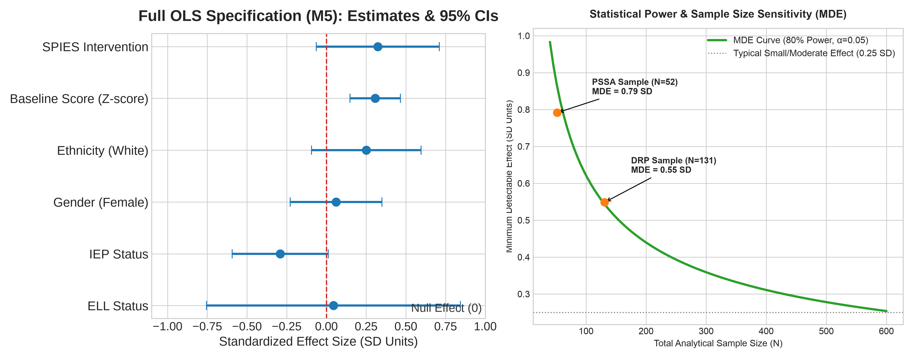
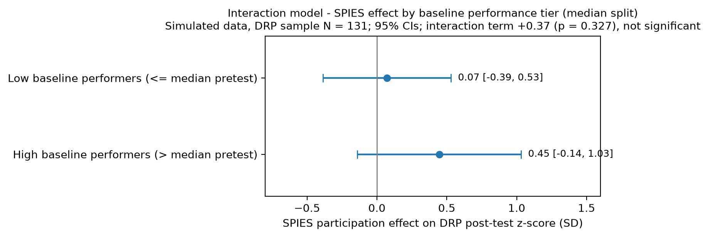
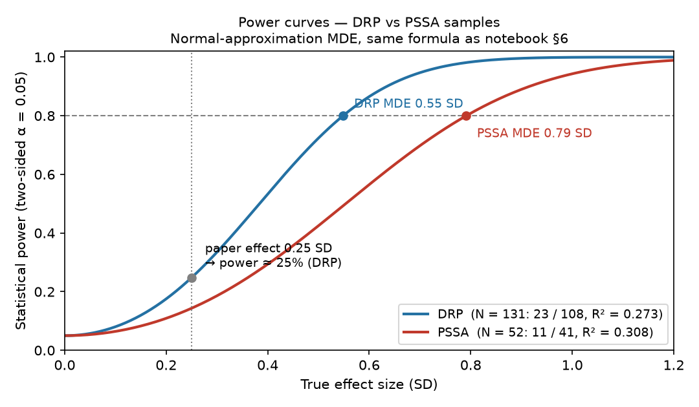
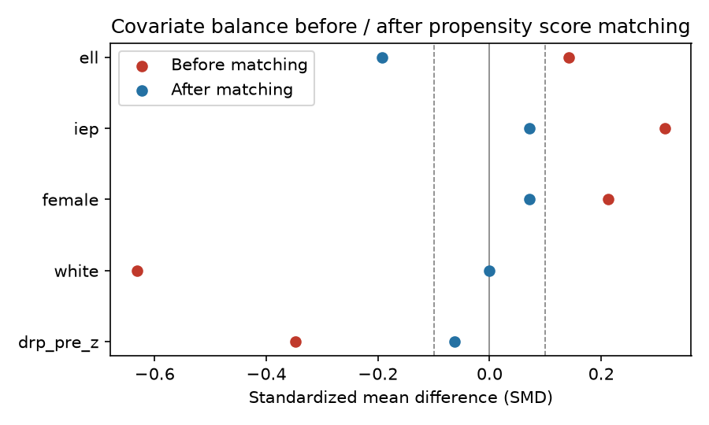
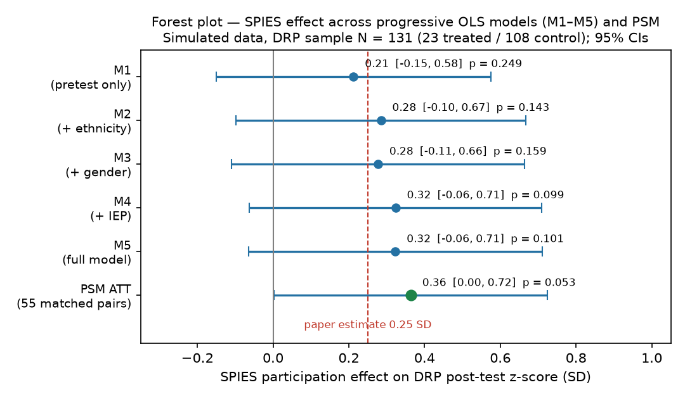

# Longitudinal Program Impact & Heterogeneous Treatment Effect Modeling



## Overview

This repository presents a quantitative statistical modeling framework designed to evaluate longitudinal intervention impacts and conditional treatment heterogeneity in observational panel data. Originally formulated as an empirical capstone study on multi-year student assessment cohorts ($N = 376$ analytical sample drawn from $1,100+$ student-year administrative records across Grades PK–5), this implementation reconstructs the full econometric workflow using reproducible Python pipelines and privacy-preserving synthetic panel data.

All data here are **simulated and de-identified** — no real student records are used. The simulation is calibrated to reproduce the paper's reported statistical structure, not its raw data.

---

## Core Quantitative Methodology

### 1. Panel Cohort Engineering & Selection Diagnostics

- **Cohort Reconstruction:** Tracked longitudinal student records across three academic cycles (2011–2014) under incomplete administrative test coverage and non-random program assignment.
- **Attrition & Balance Testing:** Executed Pearson's chi-square ($\chi^2$) diagnostics comparing the analytical cohort ($N = 376$) against excluded records ($N = 728$) to verify demographic representativeness ($p > 0.05$ across covariates), while quantifying baseline covariate imbalances between treatment ($n = 57$) and control ($n = 319$) groups.

### 2. Multi-Scale Psychometric Standardization

- Normalized heterogeneous state-level (PSSA) and local (DRP) assessment scores into within-cell $z$-scores stratified by assessment instrument, grade level, and academic year:

$$z_{i,g,t} = \frac{X_{i,g,t} - \mu_{g,t}}{\sigma_{g,t}}$$

- Enabled scale-invariant longitudinal growth comparisons across distinct student cohorts.

### 3. Progressive OLS Specifications & Subgroup Interaction Modeling

- *Sequential Specification ($M_1$–$M_5$):* Estimated nested linear regression models controlling for baseline pretest scores and demographic/institutional covariates (`IEP`, `ELL`, `Gender`, `Ethnicity`):

$$Y_{i} = \beta_{0} + \beta_{1} \text{Treatment}_{i} + \beta_{2} Y_{i,\text{pre}} + \mathbf{X}_{i}'\boldsymbol{\gamma} + \varepsilon_{i}$$

  Incorporating full covariate controls increased explained variance ($R^2$) from $0.186$ to $0.273$ in local assessment models ($N = 131$) and from $0.204$ to $0.308$ in state assessment models ($N = 52$).

- *Heterogeneous Treatment Effects (CATE):* Introduced multiplicative interaction terms ($\text{Treatment}_i \times \text{Subgroup}_i$) across baseline achievement tiers and demographic indicators to test for differential subgroup gains. In the replication's median-split specification (DRP, $N = 131$; pretest median split into low / high baseline performers), the SPIES effect is $+0.07$ SD among low performers and $+0.45$ SD among high performers, with the interaction term itself $+0.37$ ($p = 0.327$) — not significant, matching the paper's Tables 13/14 pattern of no detectable heterogeneity.


- *Early-Grade Paired Inference:* Conducted paired-sample $t$-tests on early literacy cohorts (Grades PK–1, $N = 160$) to detect short-term skill acquisition.

### 4. Statistical Power & Minimum Detectable Effect (MDE) Diagnostics

- Quantified sample-size constraints in upper-grade observational subsamples by deriving the Minimum Detectable Effect (MDE) at $\alpha = 0.05$ (two-sided) and statistical power $1 - \beta = 0.80$:

$$\text{MDE} = (z_{1-\alpha/2} + z_{1-\beta}) \sqrt{(1 - R^2)\left(\frac{1}{n_{T}} + \frac{1}{n_{C}}\right)}$$

- Demonstrated mathematically why small analytical subsamples require large effect sizes to achieve statistical significance, motivating covariate-matching (PSM/IPW) and randomized experimental designs (RCT). At the paper's sample sizes the MDE is **0.55 SD** (DRP, $N = 131$) and **0.79 SD** (PSSA, $N = 52$); at the paper's own DRP estimate of 0.25 SD, power was only about 25% — the null results are a sample-size story, not a no-effect story (see `power_curve.png`).



### 5. Propensity Score Matching (Methods Extension)

- The paper proposed covariate matching only as a future evaluation design; this repository implements it on the simulated data as a methods extension: logit propensity scores on baseline covariates, nearest-neighbor matching without replacement (caliper $= 0.2 \times$ SD of the logit score), standardized-mean-difference balance diagnostics before/after matching (see `psm_balance_love_plot.png`), and an ATT estimate benchmarked against the full-sample OLS specification. 55 of 57 treated students matched; ATT $= 0.36$ SD ($p = 0.053$) vs. OLS $0.25$ SD — same direction and magnitude, mutually reinforcing.



---

## Headline Finding (from the paper)

Controlling for baseline pre-test and demographics, the SPIES participation effect on DRP is **not statistically significant**: coefficient ≈ **0.25**, SE ≈ **0.20**, p ≈ **0.21** (N = 131); the PSSA effect is near zero (**0.055**, SE ≈ 0.34, N = 52). The replication recovers the same structure: DRP M5 $= +0.32$ (p $= 0.10$); PSSA M5 $= +0.03$ (SE $0.30$, p $= 0.92$), $R^2$ rising $0.21 \to 0.35$ against the paper's $0.20 \to 0.31$. The study was underpowered for effects of this size — the MDE analysis is the point, not a workaround for the null result.



## Methods Note — What This Simulation Can and Cannot Show

**What it can show:** that the analysis pipeline (within-cell z-score standardization, progressive OLS, interaction models, MDE, PSM) is correct, reproducible, and internally consistent with the paper's reported magnitudes; how estimators behave under a known data-generating process — e.g., standard-error scale under small samples with baseline imbalance, and how an unfixed subsample draw can flip a coefficient's sign; and the power logic — at the paper's sample sizes the MDE (0.55 / 0.79 SD) far exceeds the estimated effects, so the null results are consistent with an underpowered study and are not evidence of no effect.

**What it cannot show:** the true SPIES effect (the effect in the simulated data is an assumption written into the generator, not evidence); whether the paper's conclusions are right or wrong (a replication can only check that the reported statistical structure is internally consistent, not validate the original administrative data); and any causal claim — participation was non-random, and matching balances only observed covariates. This matches the paper's own stance: the findings are observed relationships, not causal effects. Any external citation of this repository should label the results as synthetic / simulated.

---

## Repository Structure

```
├── README.md                        # Technical methodology & econometric documentation
├── longitudinal_impact_modeling.ipynb  # Jupyter Notebook: data simulation, OLS (DRP & PSSA), interactions, MDE, PSM, methods note
├── synthetic_panel_data.csv         # Privacy-preserving synthetic panel dataset (N = 376, generated in-notebook, seed 42)
├── econometric_diagnostics.png      # Two-panel figure: M5 coefficient forest plot & MDE sample-size sensitivity curve
├── psm_balance_love_plot.png        # PSM covariate-balance (love) plot: SMD before / after matching
├── forest_plot.png                  # Coefficient forest plot: SPIES effect across M1–M5 plus PSM ATT
├── interaction_plot.png             # Interaction model: SPIES effect by baseline performance tier (median split)
├── power_curve.png                  # Statistical power curves: DRP vs. PSSA samples, MDE at 80% power
└── section8_forest_power.py         # Reproducible plotting code for forest_plot.png and power_curve.png
```

## How to Run

```bash
pip install numpy pandas scipy statsmodels jupyter
jupyter notebook longitudinal_impact_modeling.ipynb
```

Python 3.15, Jupyter Notebook 7.6.5. The notebook runs top to bottom with no errors (verified 2026-11-20); the synthetic data are generated in-notebook with fixed seeds, and `synthetic_panel_data.csv` is the exported panel for inspection.
